<div align="center">

# MMAR

**Minimal Multi-Agent Runtime**

**English** | [简体中文](README.zh-CN.md)

Agents choose how to communicate. The runtime keeps execution bounded and durable.

[](pyproject.toml)
[](pyproject.toml)
[](docs/mvp-validation.md)
[](docs/mvp-validation.md)

[Quick start](#quick-start) · [How it works](#how-it-works) · [Live model validation](#live-model-validation) · [Connect a model](#connect-a-model) · [Documentation](#documentation)

</div>


MMAR is a **small, event-driven multi-agent runtime you can embed in a Python program**. Each agent acts on its identity, memory, and incoming messages. It can send a message to selected peers, broadcast to a group, or stay silent. A shared runtime handles scheduling, concurrency, request budgets, and durable commits.

The core uses **Python + asyncio + SQLite**, with zero third-party runtime dependencies. Add HTTPX to connect a real model. MMAR is useful for bounded collaboration experiments, message-driven simulations, and prototypes that need persistent execution records.

> **Validated with a real model:** 30 agents sharing 4 execution slots, 60 committed steps, 60 consumed deliveries, and updated memory for every agent. [Read the full report →](docs/live-provider-validation.md)

## Why MMAR

Giving every role its own background loop, client, and queue increases idle resource use and lifecycle complexity as the number of agents grows. MMAR keeps agents as logical identities and delegates work to a shared runtime. Only agents with incoming work occupy execution slots.

| Design | Resulting behavior |
|---|---|
| **Message-driven activation** | Idle agents have no dedicated Task, Queue, Lock, or model client |
| **Shared execution** | Registration and concurrency are separate; 30 roles can share 4 execution slots |
| **Structured decisions** | Models return communication and memory-update intents, validated by the runtime |
| **One atomic commit** | Memory updates, outgoing messages, input consumption, and step completion commit together in SQLite |
| **Bounded runs** | Configure limits for requests, steps, deliveries, inboxes, context, and output |
| **Inspectable records** | Persist messages, events, versions, and call counts, with cursor-based reads and restart recovery |

## Quick start

Requires **Python 3.11+**. Clone the repository and run the offline demo without an API key:

```bash
git clone https://github.com/freezetheflame/mmar.git
cd mmar
python -m mmar demo --agents 10
```

This deterministic Mock demo covers multi-target sends, broadcasts, memory updates, and eventual silence. Each run creates a separate `.mmar/demo-*.db` and makes no network requests.

Install the optional API adapter with locked dependencies:

```bash
uv sync --frozen --extra api
uv run --no-sync mmar demo --agents 10
```

Alternatively, install into your virtual environment with `python -m pip install -e ".[api]"`. See [examples/discussion.toml](examples/discussion.toml) for file-based identities and memory, and the [usage guide](docs/runtime-guide.md) for detailed commands. The guide and example prompts are currently in Chinese.

## How it works

```mermaid
flowchart LR
    Input["Environment input / peer messages"] --> Inbox["SQLite persistent inbox"]
    Inbox --> Runtime["Shared runtime<br/>Claim input · Bound concurrency and budgets"]
    Runtime --> Snapshot["Identity + memory + message snapshot"]
    Snapshot --> Model["Shared ModelAdapter"]
    Model --> Decision["JSON intents<br/>Send · Broadcast · Silence · Update memory"]
    Decision --> Validate["Validate protocol, permissions, and capacity"]
    Validate --> Commit["Atomic SQLite commit<br/>Memory + output + input consumption + completion"]
    Commit --> Inbox
    Commit --> Events["Persistent events / Markdown memory export"]

    classDef store fill:#122C2B,stroke:#59D6B0,color:#E6FFF5;
    classDef execution fill:#17243B,stroke:#819FCC,color:#EDF3FF;
    class Inbox,Commit,Events store;
    class Runtime,Snapshot,Model,Decision,Validate execution;
```



**Agents choose what to say, whom to contact, and when to stay silent. The runtime validates each step and persists its outcome.** Identity and memory are data; a logical agent does not require a resident thread or service. SQLite holds authoritative state, while Markdown files support import and export.

A model decision can be small:

```json
{
  "actions": [
    {"type": "send", "targets": ["bob"], "content": "Reuse existing results to reduce repeated inference."}
  ],
  "memory_replace": "# Memory\n\n- Shared a suggestion with Bob."
}
```

`send` accepts one or more targets; `broadcast` addresses a defined group. `actions: []` means silence, and `memory_replace: null` preserves existing memory. Every decision must pass local validation before it can commit.

## Live model validation

On 2026-10-10, Intern Discovery's `deepseek-v4-flash-0731` completed a **30-agent ring test**. Each agent sent one idea to its next peer, then updated memory and stayed silent after receiving a peer message.

| Metric | Observed result |
|---|---:|
| Successfully executed / registered agents | **30 / 30** |
| Committed steps / consumed deliveries | **60 / 60** |
| Peak in-flight model calls | **4** |
| Elapsed time | **95.9 seconds** |
| Requests, including JSON repairs | **63** |
| Failed steps / pending deliveries | **0 / 0** |
| Sampled peak process working set | **42.62 MiB** |
| Provider-reported total tokens | **59,811** |

All 63 requests returned HTTP 200. Three outputs needed a JSON repair; all repaired steps committed successfully. These figures exclude one connectivity probe. This test validates a bounded communication workflow; it does not establish the quality or throughput of long-running, open-ended discussions.

An offline scale test also exercised **1,000 registered agents**: idle background asyncio tasks stayed at **2**, with a local process working set of approximately **30.89 MiB**. These agents shared 4 execution slots. Mock throughput is not real-model throughput. See the [live model report](docs/live-provider-validation.md) and [resource measurements](docs/mvp-validation.md) for methodology and limitations.

## Connect a model

The optional adapter supports OpenAI-style **Chat Completions**. Set an API root such as `https://example.com/v1`; the adapter appends `/chat/completions`.

Example for PowerShell 7:

```powershell
$env:MMAR_API_KEY = Read-Host "API key" -MaskInput
$env:MMAR_API_BASE = "https://discovery-api.intern-ai.org.cn/v1"
$env:MMAR_MODEL = "deepseek-v4-flash-0731"
$env:MMAR_TOKEN_PARAMETER = "max_tokens"
$env:MMAR_JSON_MODE = "1"

try {
    uv run --no-sync mmar demo --api --agents 3 --calls 10 --concurrency 2 --rate 1
} finally {
    Remove-Item Env:MMAR_API_KEY
}
```

`--calls` includes failures, retries, and JSON repairs. `--rate` applies a shared request rate limit, and `--output-tokens` bounds generation per request. Other compatible services may require `max_completion_tokens`, or `MMAR_JSON_MODE=0` to disable provider JSON mode. Local validation always remains enabled.

Keys are used only in the client's Authorization header, never in agent prompts, SQLite, or logs. `.env.example` is a configuration template; the program does not automatically load `.env`. Default databases live in the Git-ignored `.mmar/` directory. File-based examples also export each agent's Markdown memory.

To reproduce the bounded 30-agent test, use the same provider settings and enter the key again:

```powershell
$env:MMAR_API_KEY = Read-Host "API key" -MaskInput
try {
    uv run --no-sync python -m benchmarks.live_scale --agents 30 --concurrency 4 --calls 80 --output-tokens 512 --rate 2 --timeout 300
} finally {
    Remove-Item Env:MMAR_API_KEY
}
```

This command consumes real API quota. Use a fresh run and explicit limits when comparing configurations. For additional provider and lifecycle details, see the [usage guide](docs/runtime-guide.md#接入真实模型).

## Embed in Python

```python
import asyncio
from mmar import Limits, MockModel, Runtime

async def main():
    async with await Runtime.open(
        ".mmar/custom.db", model=MockModel(), limits=Limits(concurrency=2)
    ) as runtime:
        await runtime.register_agent("alice", identity="You are Alice, a researcher.")
        await runtime.register_agent("bob", identity="You are Bob, an engineer.")
        await runtime.create_session("discussion", ["alice", "bob"])
        await runtime.inject_message("discussion", "alice", "Start the discussion", "seed-1")
        await runtime.start()
        print(await runtime.wait_idle("discussion", timeout=30))

asyncio.run(main())
```

`MockModel()` is silent by default. Pass a synchronous or asynchronous `policy(snapshot)`, or substitute a real model adapter. A custom adapter implements only `complete(snapshot, repair=False)` and `aclose()`; each complete makes at most one model request.

The Python API also supports agent registration and retirement, sessions and groups, pause and resume, stop and drain, memory import and export, explicit budget reset, and event cursors. [Read the API and runtime semantics →](docs/runtime-guide.md#python-环境接口)

## Current scope

MMAR is a **v0.1 MVP** with a Python API and CLI. Agent actions are limited to messaging. Tool execution, a web management UI, and autonomous timers are not implemented. The host environment drives experiments through messages and `activate`.

Crash recovery retains committed outcomes and restores uncommitted input within configured retry limits. External model requests may already have executed; retries do not guarantee single billing. Token metrics use provider-reported values and are not an exact monetary budget. Memory is shared across sessions for the same agent; use different IDs for isolation. Text versions and events are not yet automatically archived, so long-running deployments need disk management.

## Documentation

Detailed design and validation documents are currently in Chinese; both READMEs include setup, architecture, results, and API examples.

| Topic | Start here |
|---|---|
| Installation, provider configuration, file examples, and runtime semantics | [Usage guide](docs/runtime-guide.md) |
| Real-model 30-agent validation and limitations | [Live model validation](docs/live-provider-validation.md) |
| Test coverage and resource measurements for 10 / 100 / 1,000 agents | [MVP validation](docs/mvp-validation.md) |
| Original goals and final architecture | [v0.4 design](docs/mmar-v0.4-design.md) |
| Three rounds of design review | [Review audit](docs/reviews/mmar-review-audit.md) |
| Current optimization priorities and offline reproductions | [v0.1 optimization review](docs/optimization-review-v0.1.md) |

## Development and verification

```bash
uv sync --frozen --extra api
uv run --no-sync python -m unittest discover -v
```

**47 tests** passed on Python 3.11 and 3.12, including real subprocess termination before, during, and after commit. Unit tests make no real model requests. Reproduce the offline scale measurements with:

```bash
uv run --no-sync python -m benchmarks.mock_scale --output docs/benchmarks/mock-scale.json
```

Issues with reproducible problems, concrete use cases, and experiment results are welcome. Include your Python version, run parameters, and redacted error details.

---

<div align="center">

**Many agents. One runtime.**

Identity and memory belong to agents. Scheduling and persistence belong to the runtime.

</div>
