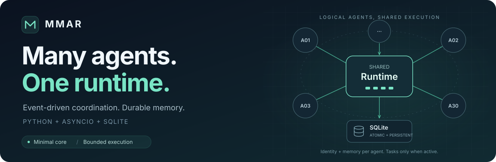

<div align="center">

# MMAR

**Minimal Multi-Agent Runtime**

[English](README.md) | **简体中文**

让 Agent 自主交流，让 Runtime 管住执行。

[](pyproject.toml)
[](pyproject.toml)
[](docs/mvp-validation.md)
[](docs/mvp-validation.md)

[快速开始](#快速开始) · [工作方式](#工作方式) · [真实模型实测](#真实模型实测) · [接入模型](#接入模型) · [文档](#文档)

</div>



MMAR 是一个 **轻量、事件驱动、可嵌入 Python 程序的多 Agent 运行时**。每个 Agent 由身份、记忆和收到的消息驱动，可以选择同伴发送消息、向群组广播，或保持沉默。共享 Runtime 负责调度、并发限制、请求预算与可靠提交。

核心采用 **Python + asyncio + SQLite**，没有第三方运行依赖。连接真实模型时，只需额外安装 HTTPX。适合有限规模的多 Agent 协作实验、消息驱动的模拟，以及需要保留执行记录的原型。

> **已完成真实模型验证：** 30 个 Agent、4 个执行槽位，60 个 step 全部提交，60 次投递全部消费，30 份记忆全部更新。[查看完整记录 →](docs/live-provider-validation.md)

## 为什么做 MMAR

Agent 数量增长时，每个角色都拥有后台循环、客户端和独立队列，会增加闲置资源与生命周期管理成本。MMAR 将 Agent 保留为逻辑身份，把实际工作交给共享运行时；只有收到输入的 Agent 才占用执行槽位。

| 设计 | 带来的行为 |
|---|---|
| **按消息唤醒** | 没有输入的 Agent 不持有独立 Task、Queue、Lock 或模型客户端 |
| **共享执行** | 注册数量与并发分开设置；30 个角色可以共用 4 个执行槽位 |
| **结构化意图** | 模型只返回通信与记忆更新意图，Runtime 校验后执行 |
| **一次事务提交** | 记忆更新、输出消息、输入消费和 step 完成状态整体落入 SQLite |
| **有限运行** | 请求、step、投递、收件箱、上下文和输出都可以设置上限 |
| **记录可检查** | 消息、事件、版本与调用计数持久保存，支持游标读取和重启恢复 |

## 快速开始

需要 **Python 3.11+**。克隆后即可运行离线示例，无需 API key：

```bash
git clone https://github.com/freezetheflame/mmar.git
cd mmar
python -m mmar demo --agents 10
```

这个确定性 Mock 示例会演示多目标发送、广播、记忆更新与最终沉默。每次创建独立的 `.mmar/demo-*.db`，不会发出网络请求。

使用锁定依赖安装真实模型接口：

```bash
uv sync --frozen --extra api
uv run --no-sync mmar demo --agents 10
```

也可以使用 `python -m pip install -e ".[api]"` 安装到自己的虚拟环境。文件身份与记忆示例见 [examples/discussion.toml](examples/discussion.toml)，完整操作见 [使用指南](docs/runtime-guide.md)。

## 工作方式

```mermaid
flowchart LR
    Input["环境输入 / 同伴消息"] --> Inbox["SQLite 持久收件箱"]
    Inbox --> Runtime["共享 Runtime<br/>领取输入 · 限制并发与预算"]
    Runtime --> Snapshot["身份 + 记忆 + 消息快照"]
    Snapshot --> Model["共享 ModelAdapter"]
    Model --> Decision["JSON 意图<br/>发送 · 广播 · 沉默 · 更新记忆"]
    Decision --> Validate["校验协议、权限和容量"]
    Validate --> Commit["SQLite 原子提交<br/>记忆 + 输出 + 输入消费 + 完成状态"]
    Commit --> Inbox
    Commit --> Events["持久事件 / Markdown 记忆导出"]

    classDef store fill:#122C2B,stroke:#59D6B0,color:#E6FFF5;
    classDef execution fill:#17243B,stroke:#819FCC,color:#EDF3FF;
    class Inbox,Commit,Events store;
    class Runtime,Snapshot,Model,Decision,Validate execution;
```



**Agent 决定说什么、说给谁，以及何时沉默；Runtime 决定这一步是否允许执行，并可靠地记录结果。** 身份与记忆是数据，逻辑 Agent 不对应一个常驻线程或服务。SQLite 保存权威状态，Markdown 文件用于导入和导出。

一次模型输出可以很小：

```json
{
  "actions": [
    {"type": "send", "targets": ["bob"], "content": "先复用已有计算结果，减少重复推理。"}
  ],
  "memory_replace": "# Memory\n\n- 已向 Bob 分享建议。"
}
```

`send` 支持一个或多个目标，`broadcast` 面向已定义的群组。`actions: []` 表示沉默，`memory_replace: null` 表示保留当前记忆。模型输出需通过本地校验才能提交。

## 真实模型实测

2026-10-10，使用 Intern Discovery 的 `deepseek-v4-flash-0731`，完成 **30 Agent 环形通信**：每位 Agent 向下一位发送一条观点，接收同伴消息后更新记忆并沉默。

| 指标 | 实测结果 |
|---|---:|
| 成功执行 / 注册 Agent | **30 / 30** |
| 成功提交 step / 消费投递 | **60 / 60** |
| 在途模型调用峰值 | **4** |
| 耗时 | **95.9 秒** |
| 请求数，含 JSON 修复 | **63** |
| 失败 step / 待处理投递 | **0 / 0** |
| 采样进程工作集峰值 | **42.62 MiB** |
| 提供方报告总 tokens | **59,811** |

所有 63 次请求返回 HTTP 200；其中 3 次输出需经过 JSON 修复，修复后均提交成功。以上不含 1 次连通性调用。该测试验证有限通信流程，尚不能代表长期自由讨论的质量或吞吐。

离线规模测试还验证了 **1,000 个注册 Agent**：闲置后台 asyncio 任务保持为 **2 个**，本机进程工作集约 **30.89 MiB**。这些 Agent 共用 4 个执行槽位；Mock 吞吐不等同于真实模型吞吐。完整数据见 [真实模型报告](docs/live-provider-validation.md) 和 [资源测量](docs/mvp-validation.md)。

## 接入模型

支持 OpenAI-style **Chat Completions**。设置 API 根路径，例如 `https://example.com/v1`；适配器会追加 `/chat/completions`。

PowerShell 7 示例：

```powershell
$env:MMAR_API_KEY = Read-Host "API key" -MaskInput
$env:MMAR_API_BASE = "https://discovery-api.intern-ai.org.cn/v1"
$env:MMAR_MODEL = "deepseek-v4-flash-0731"
$env:MMAR_TOKEN_PARAMETER = "max_tokens"
$env:MMAR_JSON_MODE = "1"

try {
    uv run --no-sync mmar demo --api --agents 3 --calls 10 --concurrency 2 --rate 1
} finally {
    Remove-Item Env:MMAR_API_KEY
}
```

`--calls` 包含失败、重试与 JSON 修复；`--rate` 共享限速；`--output-tokens` 限制单次输出。兼容服务也可选 `max_completion_tokens`，或设置 `MMAR_JSON_MODE=0` 关闭提供方 JSON mode。本地校验始终启用。

Key 仅用于客户端的 Authorization header，不写入 Agent 提示词、SQLite 或日志。`.env.example` 是配置模板，程序不会自动读取 `.env`。默认运行数据库保存在被 Git 忽略的 `.mmar/`；文件示例会另外导出各 Agent 的 Markdown 记忆。

30 Agent 实测的复现命令与完整说明见 [使用指南](docs/runtime-guide.md#接入真实模型)。

## 嵌入自己的 Python 程序

```python
import asyncio
from mmar import Limits, MockModel, Runtime

async def main():
    async with await Runtime.open(
        ".mmar/custom.db", model=MockModel(), limits=Limits(concurrency=2)
    ) as runtime:
        await runtime.register_agent("alice", identity="你是研究员 Alice。")
        await runtime.register_agent("bob", identity="你是工程师 Bob。")
        await runtime.create_session("discussion", ["alice", "bob"])
        await runtime.inject_message("discussion", "alice", "开始讨论", "seed-1")
        await runtime.start()
        print(await runtime.wait_idle("discussion", timeout=30))

asyncio.run(main())
```

`MockModel()` 默认保持沉默。可以传入同步或异步 `policy(snapshot)`，也可替换为真实模型 Adapter。自定义 Adapter 只需实现 `complete(snapshot, repair=False)` 和 `aclose()`；每次 complete 至多发出一次模型请求。

通过 Python API 还可管理注册与注销、会话与群组、暂停与恢复、停止与 drain、记忆导入导出、预算重置，以及事件游标。[查看接口与运行语义 →](docs/runtime-guide.md#python-环境接口)

## 当前边界

MMAR 当前为 **v0.1 MVP**，核心提供 Python API 与 CLI。Agent 的 Action 限于消息通信；尚无工具执行、Web 管理界面或自动定时唤醒。环境可以通过消息和 `activate` 驱动实验。

崩溃恢复保留已提交结果，未提交输入按配置限次恢复；外部模型调用可能已经发生，重试不保证只计费一次。Token 指标采用提供方报告值，不能作为精确金额预算。同一 Agent 的记忆跨会话共享；需要隔离时使用不同 ID。文本版本与事件尚未自动归档，长期运行需管理 Store 的磁盘使用。

## 文档

| 想了解什么 | 从这里开始 |
|---|---|
| 安装、API 配置、文件示例和运行时语义 | [使用指南](docs/runtime-guide.md) |
| 30 Agent 真实模型验证与限制 | [真实模型验证](docs/live-provider-validation.md) |
| 测试覆盖与 10 / 100 / 1,000 Agent 资源测量 | [MVP 验证记录](docs/mvp-validation.md) |
| 原始目标与最终架构 | [v0.4 设计](docs/mmar-v0.4-design.md) |
| 三轮设计评审过程 | [评审记录](docs/reviews/mmar-review-audit.md) |
| 当前优化优先级与离线复现 | [v0.1 优化评审](docs/optimization-review-v0.1.md) |

## 开发与验证

```bash
uv sync --frozen --extra api
uv run --no-sync python -m unittest discover -v
```

已在 Python 3.11 与 3.12 上通过 **47 项测试**，包括真实子进程强制退出下的提交前、提交中、提交后恢复。单元测试不请求真实模型。复现离线规模测量：

```bash
uv run --no-sync python -m benchmarks.mock_scale --output docs/benchmarks/mock-scale.json
```

欢迎用 issue 分享可复现的问题、真实场景和实验结果。提交问题时请附 Python 版本、运行参数和已脱敏的错误信息。

---

<div align="center">

**Many agents. One runtime.**

身份与记忆属于 Agent，调度与持久性交给 Runtime。

</div>
