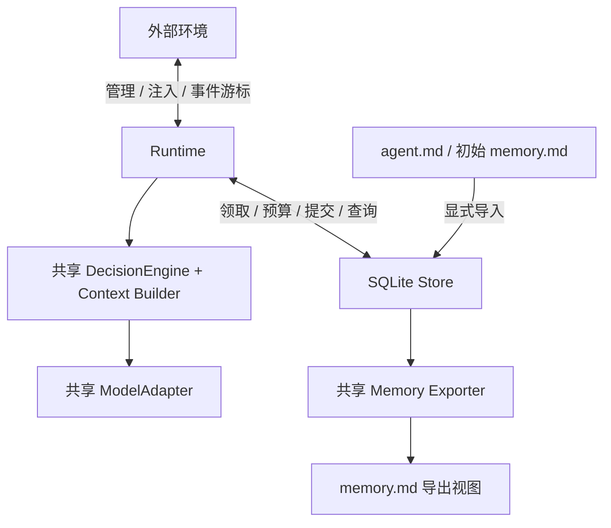

# Minimal Multi-Agent Runtime（MMAR）
## v0.4 架构建议稿：轻量 Agent 与可靠执行

**日期：** 2026-10-10  
**状态：** 完成三轮设计评审，可作为 MVP 实现基线；尚未通过运行时实现验证。  
**输入：** 用户提供的 v0.1 Draft。  
**实现目标：** Python 3.11+、单进程、asyncio、SQLite、共享 LLM Adapter。

## 1. 最终建议

保留原文档的方向：Agent 自主决定通信，Runtime 提供执行约束，环境决定世界规则。

进一步收敛为：

```text
Agent：一个 ID、一份身份定义、一段外置的持久记忆。
Step：共享执行器读取快照，调用模型，返回通信和记忆更新意图。
Runtime：领取输入、控制并发与预算、验证决策、整体提交、发布事件。
```

Agent 是逻辑身份，不是独立运行的服务。无需 Agent 基类、后台循环、独立消息队列、锁、模型客户端、线程、工具系统或内部规划器。收件箱是 Store 中属于它的投递记录，执行任务仅在激活时存在。

“轻量”分别衡量：闲置 Agent 的内存、常驻任务数量、共享运行时复杂度、每次推理的上下文和请求成本。减少 Python 对象不能减少模型本身的推理成本；这四项需要分别测量。

### 与 v0.1 的主要变化

| 项目 | v0.4 建议 | 原因 |
|---|---|---|
| Agent 对象 | 小型描述记录 + 共享执行器 | 避免每个 Agent 携带基础设施 |
| Message Bus / Scheduler | Runtime 内部职责 | 不必在 MVP 中建立独立组件协议 |
| 记忆权威来源 | SQLite 中的 Markdown 文本 | 记忆与消息可以同事务提交 |
| `memory.md` | 初始化输入、导出视图、显式导入接口 | 保留人类可读性，避免两个真源 |
| 沉默 | `actions=[]` | 删除与空行动等价的 `noop` |
| 记忆替换 | `memory_replace: string | null` | 保留整段替换，去掉只有一个选项的 mode |
| 消息与投递 | 分开建模 | 一条群组消息可以有多个独立消费状态 |
| 上下文 | 增加会话通信目录 | 自主选择目标需要可见目标集合 |
| 多会话输入 | 同一 step 只处理一个 session | 输出归属、预算和历史不含糊 |
| 停止 | 持久状态屏障 + 取消任务 | 防止旧模型结果在停止后提交 |
| 扩展点 | ModelAdapter、环境 API | 暂不引入全组件插件框架 |

## 2. MVP 范围

必须支持：身份加载、持久记忆、单目标与多目标通信、群组广播、沉默、自主选目标、异步并发、动态注册与注销、事件记录、运行控制、环境输入与输出订阅。

暂不支持：Agent 创建或删除其他 Agent、工具和任意代码执行、自行修改身份、定时自主唤醒、Workflow/DAG、分布式执行、RAG、向量库、世界动作、自动记忆整理。

单个 Store 由一个 Runtime 实例独占管理。可运行多个隔离的 Runtime，但 MVP 不提供它们之间的 Agent 通信。核心不依赖复杂 Agent Framework。

## 3. 系统结构



建议只保留五项实现职责：协议数据结构、Runtime、上下文构造与共享执行器、ModelAdapter、Store。Memory Exporter 是文件视图工具，可以放在 Store 模块，不需要成为新框架。

```text
mmar/
  protocol.py     # AgentSpec / 输入 / Decision / Event / Limits
  runtime.py      # 注册、调度、路由、生命周期、校验
  context.py      # 构造受限快照和模型输入
  model.py        # 共享模型协议和具体 Adapter
  store.py        # SQLite 事务、恢复、Markdown 导入导出
examples/
  simple_chat.py
  group_discussion.py
tests/
```

文件可在变大后拆分。设计不要求一开始复制所有概念到独立模块。

## 4. Agent 的最小定义

概念模型保持：`Agent = (ID, Identity, Memory)`。

运行时注册记录只持有小型元数据，例如：

```python
@dataclass(frozen=True, slots=True)
class AgentSpec:
    agent_id: str
    identity_ref: str  # Store 中的身份版本引用，不是模型可访问的文件路径
```

生命周期、记忆版本、执行记录属于 Store；不要求把它们复制到 Agent 实例。展示名可作为可选元数据。身份和记忆正文按需读取，可用总字节数受限的共享缓存；不要给每个 Agent 保留无上限的历史缓存。

身份和记忆版本是 Store 中不可变的文本版本，Agent 记录只指向当前版本。step 引用所用版本，并保存有限目录和输入清单；无需每轮重复保存整份身份文本。历史版本至少保留到关联执行记录不再需要审计时。

执行器的职责：

```text
decide(StepSnapshot, ModelAdapter) -> Decision
```

它只组织输入和请求模型；不直接读写文件、不投递消息、不管理调度、不提交记忆。模型调用有网络副作用，因此这个函数不被宣称为数学上的纯函数。

所有 Agent 在 MVP 中使用共享的模型策略。未来可由宿主配置不同模型，但不需要让每个 Agent 自带 Adapter。

### 身份与人工维护

- `agent.md` 仍是用户维护的身份源文件。
- 注册时校验并导入不可变的身份快照，记录版本和摘要。
- 修改文件后需显式 reload；运行时不逐轮重新扫描文件，也不自动接受文件变化。
- reload 和人工记忆导入只允许在 Runtime 已暂停且没有在途 step 时执行。
- 模型只见正文，不见本地路径；模型输出不能指定路径。
- Agent ID 采用长度受限的安全标识符，与实际目录路径分开映射。

## 5. 会话、目录与自主性

`session_id` 表示一次有独立参与者、群组和预算的讨论单元。MVP 不再同时引入含义重叠的 `conversation_id`。需要多个话题时由环境创建多个 session。

会话配置包括：参与者 ID、群组、群组发言权限、固定资源限制。参与者是可通信的集合，不是固定发言顺序或 Supervisor 关系。

每轮输入包含完整的本会话通信目录：

```json
{
  "self": "alice",
  "peers": ["bob", "charlie"],
  "groups": [{"id": "research", "can_send": true, "recipient_count": 2}]
}
```

仅列 ID 和必要权限；不用把其他人的完整身份与记忆塞进上下文。`peers` 不含自己；默认不允许给自己发送消息。群组广播默认不回送发送者。

目录有独立上下文预算。创建或修改 session 时必须验证其完整目录能放入所有参与者的输入限制；超过则明确拒绝。MVP 不静默隐藏目标、不做分页发现工具。大量注册 Agent 可以分属不同会话；如果确实需要 1,000 人共享完整可见目录，需提高上下文预算并测量成本，不能用注册规模代替这项验证。

一个 Agent 可以参与多个 session，但其 step 在所有 session 间串行，记忆仍是同一个逻辑个体的共享记忆。这不是会话隐私隔离。如果需要隔离记忆，应注册不同 Agent ID；不再自动创建“Agent × Session”的独立记忆实例。

模型执行期间目录可能变化；提交时重新检查当前权限与收件人。过期目录不授予权限。

### 主动行为的准确边界

Agent 被消息、环境事件或显式 activate 唤醒后，可以联系任何当前允许的目标，不必回复原发送者。它可以连续发送多条消息、广播或沉默。

没有输入时它不会自行醒来。这是 Reactive Runtime 的边界；定时器、tick 或外部世界变化由环境注入激活事件。不要用每个 Agent 的常驻循环模拟自主性。

## 6. 决策协议

模型只生成以下结构：

```json
{
  "actions": [
    {"type": "send", "targets": ["bob", "charlie"], "content": "我们讨论一下这个问题。"},
    {"type": "broadcast", "group": "research", "content": "请提出你的看法。"}
  ],
  "memory_replace": null
}
```

沉默与只更新记忆：

```json
{"actions": [], "memory_replace": "# Memory\n\n- Bob 关注分布式系统。"}
```

要求字段齐全，拒绝未知字段和不支持的 Action。send 的 targets 非空，同一 Action 内不能重复；不同 Action 可以向同一目标发送不同消息，分别计数。空白消息和空的记忆替换无效；清空记忆需显式写入合法的最小文本，例如 `# Memory`。

模型不得提供 sender、session_id、message_id、step_id、created_at、角色权限、文件路径或预算。它们由 Runtime 生成或继承。

校验分为三层：

1. 结构：JSON、字段、类型、大小、Action 数量。
2. 语义：目标存在且处于 active 状态、未被 Agent 预算封锁、属于当前 session、群组存在、发送者有发言权限。
3. 提交条件：当前会话未停止、step 尚未提交、版本匹配、实际 fan-out 和各收件箱容量符合约束。

整轮采用 all-or-nothing。一个 Action 非法或某个目标收件箱满，都不会出现部分消息已发出、部分失败或记忆单独更新。输入最终标记失败并记录原因。MVP 不自动丢弃有问题的 Action，也不让模型无限“修复”权限或容量错误。

## 7. 消息与投递

消息保存一次正文；投递描述每个接收者的独立处理状态。

```text
Message:
  message_id, session_id, sender, kind, content,
  target_spec, origin_step_id?, action_index?, created_at

Delivery:
  delivery_seq, message_id, recipient_id,
  state, claimed_step_id?, recovery_count
```

`kind` 可为 direct、multicast、group、external、activation。sender 是 Runtime 写入的 Agent ID 或宿主配置的环境来源标识；消息 kind 不等于模型 API 的 system 角色。

- 每个模型 Action 对应一条 Message；send 多目标不重复保存正文。
- `UNIQUE(message_id, recipient_id)` 防止同一消息重复投递给同一 Agent。
- `UNIQUE(origin_step_id, action_index)` 防止同一个已提交 Action 重建消息。
- 同一 Agent 的输入顺序以 Store 分配的 `delivery_seq` 为准，不使用客户端时间戳排序。
- created_at 使用 Runtime 的 UTC 时间，主要用于观察。
- 外部注入通过 `(source, request_id)` 幂等；保存规范化负载摘要。同键同负载返回既有回执，同键不同负载返回冲突。
- 幂等记录保留期限必须覆盖客户端重试期限；清理后不再承诺历史请求去重。

投递状态：

```text
pending -> claimed -> consumed
                   -> failed
                   -> cancelled
                   -> pending  # 仅限有界的崩溃恢复
pending ----------> cancelled  # 停止、注销、预算终止
```

`consumed` 表示该输入对应的合法决策已整体提交；可以是沉默。`failed` 表示本轮最终失败，不自动反复激活。重新尝试失败输入是环境的显式操作，生成新输入并引用原始 ID。

日志明确区分 message.accepted、delivery.claimed、delivery.consumed，不用含糊的 delivered 同时表示入箱和处理完成。

### 群组展开

在最终提交事务中，以当前群组成员和权限展开收件人，去重并排除发送者。全部成员必须属于该 session；注销时事务性移除相关成员和权限。

记录实际接收者的投递行和群组版本，便于事后追踪。目录中的 recipient_count 是快照提示，不是额度承诺。展开后为空的广播无效；展开后超限则整轮拒绝。

## 8. 调度与批处理

共享调度器维护一个 active 映射，大小不超过并发上限 C；保存当前 Agent 与 step Task 的对应关系。无需每 Agent 一把 asyncio.Lock。

仅在有可用执行槽位时创建 step Task。不要先为所有待执行 Agent 创建 Task 再等 semaphore。一个有界调度提示缓存可以加速查询，但 Store 中的 pending 投递是唯一真源，丢失提示不能丢失任务。

调度过程：

1. 有执行槽位时，按 Agent 轮转选择有 pending 输入且未 active 的 Agent。
2. 在该 Agent 的非终止 session 间轮转；一次只选择一个 session。
3. 按 delivery_seq 领取该 session 的有限输入前缀，同时创建 running step、记录版本、预留 step 次数。
4. 读取身份、记忆、目录和受限历史，构造不可变快照。
5. 创建执行任务。此 Agent 在任务彻底退出前不能再次领取。
6. 任务结束后移出 active；重新查询该 Agent 是否还有 pending 输入。

领取也受数据库唯一约束保护：同一 agent_id 最多有一个 running step。in-memory active 是任务管理结构，不是恢复真源。

公平性采用有限批次的轮转，不使用“哪个消息最多就一直执行谁”。Agent 暂时没有输入则退出待调度集合；轮转顺序不固定模型通信拓扑。MVP 需要测试无持续饥饿，但不宣称严格实时调度。

当无槽位时不领取输入。C 限制整个 step 生命周期，包括模型等待和有限退避，所以实际同时发出的模型请求不会超过 C；这更保守，也更容易实现。C 不是 QPS 限制，模型 Adapter 可配置共享请求速率限制。

批处理同时受消息数和输入预算限制。保持顺序且不静默丢输入。如果最早一条合法输入仍无法放入上下文，记录 context_overflow 并把它标记 failed，继续调度后续输入，避免永久卡住。

## 9. 一次 step 的事务边界

整个协议有三类短事务，模型调用始终在事务外。

### A. Claim

- 检查 Runtime 允许领取、session 可运行、Agent active、没有其他 running step。
- 检查并预留全局、session、Agent 的 step 次数。
- 创建 step_id，保存 session epoch、身份版本、记忆版本、有界目录快照和输入清单；批次选择使用与 Context Builder 一致的预算规则。
- 将选中的 pending 投递标记 claimed。

### B. Reserve attempt

每次实际模型请求前，检查 step 和控制状态，原子预留请求次数并创建 attempt 记录。重试和格式修复也经过此事务。预留后不退款，即使取消发生在真正发出请求前；保守计数比低估消耗更容易解释。

### C. Commit decision

同一 SQLite 事务内：

1. 如果 step 已 committed，返回既有回执。
2. 否则要求 step 仍 running、session epoch 匹配且允许当前任务完成、Agent active、身份和记忆版本匹配。
3. 展开并校验全部消息，包括收件箱容量和实际投递数预算。
4. 保存可空的记忆替换并递增 memory_revision，标记导出视图待同步。
5. 插入输出 Message 和 Delivery，事务性递增实际投递计数。
6. 把本轮 claimed 输入改为 consumed。
7. 保存 Decision、step committed 状态、使用量和事件。
8. 提交事务。

任意失败均回滚整个 C；不允许只完成前半段。校验失败后另一个短事务标记 step failed 和输入 failed；如果故障导致该失败事务也无法落盘，Runtime 停止正常执行并报告基础设施故障，等待恢复处理，而不是在内存里假装已失败。

SQLite 的原子提交针对同一数据库事务；它不能自动覆盖一个旁路写入的 Markdown 文件。这是统一记忆真源的依据。[SQLite 原子提交说明](https://www.sqlite.org/atomiccommit.html)

### 并发新消息与提交重试

Agent 推理期间新到输入仍为 pending，不并入当前快照。成功提交后再领取下一批。失败后的内存通知可以重建，消息本身已经在 Store 中。

如果客户端没有收到 Commit 回执，查询 step_id 决定结果。已提交就返回旧结果；未提交才在原 step 仍有效时重试提交。不能重新调用模型来“确认有没有发成功”。

这只保证单个 step 的状态变更最多提交一次，不保证远端 LLM 请求只处理一次，也不保证崩溃后重新推理得到同样答案。

## 10. Markdown 与记忆一致性

注册时导入 agent.md 和初始 memory.md。之后 SQLite 保存权威身份快照和记忆文本，Markdown 文件是可再生视图与人工维护入口。

共享 Exporter 按 dirty revision 查询并导出记忆，使用受控目录、同目录临时文件和原子替换；同时记录 exported_revision。只保留一个共享导出任务，不为每个 Agent 创建任务或无上限的导出队列。

- 导出失败不撤销已经提交的 step，也不重新发送消息。
- 较旧版本正在导出时，较新记忆更新仍可提交；旧导出不能把新版本标为已同步。
- 查询接口可以显示当前 memory_revision 与 exported_revision，暴露视图延迟。
- `flush_exports(timeout=...)` 返回同步状态；超时或权限错误有明确报告。
- 重启后扫描 dirty 状态补齐视图，不重新执行已提交 step。
- 导出视图不要作为正在运行时自动监听的写入口。人工修改通过暂停后的显式 import 生效。
- 导入附带 expected_revision，检测外部管理客户端的过期覆盖。

这是对 v0.1 的有意调整：保留 `memory.md` 的可读与可编辑工作流，但它不是唯一持久存储。若坚持让文件成为唯一真源，需要新增跨介质恢复日志，或接受记忆与通信不原子；本版选择避免这两种代价。

记忆跨 session 共享且串行更新。替换是完整替换，仍可能由模型遗忘有价值的信息；MVP 通过长度限制、版本记录和显式恢复支持观察与纠正，不引入自动摘要模型。

## 11. Store 的最小实现

建议一个 SQLite 文件、一个连接、一个共享工作线程。全部数据库操作经过有界请求桥接，连接在该线程创建和使用；Agent 不持有连接。事务中没有网络请求、模型推理、Markdown 导出或用户回调。

线程数量是固定基础设施开销，与注册 Agent 数量无关。相比直接在 asyncio loop 中执行磁盘同步，这能避免把慢磁盘提交直接放入模型调度路径。

桥接契约：

- 命令已接纳后，即使调用方协程被取消，也不假设数据库命令撤销。
- 控制屏障与提交命令在同一串行通道处理；合法性在事务内检查，不仅在排队前检查。
- 若提交先于 stop 屏障完成，它是停止之前的有效结果；若在屏障之后处理，必须拒绝。
- 回执丢失通过 step 或 request_id 查询，不凭 Future 的取消状态判定提交失败。
- 队列满时返回 runtime_busy；接入层不得无限堆积内部请求。
- Store 关闭需等已接纳命令结算；停止推理任务和关闭 Store 是不同步骤。

默认可使用 rollback journal、`synchronous=FULL`、启用外键和有限 busy timeout。单连接并不因为 LLM 并发就需要 WAL；将来有测量依据再采用 WAL 和独立读连接。SQLite 的同步级别与持久性有关，应记录实际设置和运行时 SQLite 版本。[SQLite synchronous 配置](https://www.sqlite.org/pragma.html#pragma_synchronous)

启动时获得 Store 级进程排他所有权，失败就拒绝启动第二个 Runtime；SQLite 的短写事务锁不能替代运行时独占约束。Store 使用本地文件系统。

建议的逻辑数据集合：

| 集合 | 保存内容 |
|---|---|
| runtime_control / budget | 实例状态、持久请求与 step 计数、停止原因 |
| agents / text_revisions | ID、生命周期、当前版本引用、不可变身份与记忆文本、导出状态 |
| sessions / participants | 会话状态、epoch、策略、参与者、轮转元数据 |
| groups | 会话内群组、成员、发送权限、版本 |
| messages | 原始正文、来源、会话、Action 关联、外部幂等键 |
| deliveries | 投递顺序、接收者、处理状态、step 关联、恢复次数 |
| steps / attempts | 输入与版本快照、决策、请求预留、使用量、最终状态 |
| events | 单调 seq、种类、关联 ID、有限附加数据 |

实现时可合并部分表，但不能删除对应语义。pending 与运行中的 step 需要索引；按接收者、会话、状态和 delivery_seq 查询，避免每次轮询扫描所有历史。

无需单独 outbox：Runtime 内部通信直接在上述事务里生成持久 Delivery。事件消费者的外部副作用仍需由消费者自行提供幂等性。

## 12. 预算、背压与终止

预算分三类，避免都叫“消息数量”：

| 限制 | 计数与时机 |
|---|---|
| 并发 C | 最多 C 个在途 step，任务创建前占槽位 |
| 每 step Action 数 | 模型输出验证时限制 |
| 每 Action 目标数 / 每 step fan-out | 广播展开后按实际 Delivery 计数 |
| 正文与记忆大小 | 输入接纳、上下文构造、输出验证分别检查 |
| 每 Agent 收件箱容量 | 所有 session 的 pending + claimed 合计 |
| Runtime 总未完成输入 | 所有 pending + claimed 合计 |
| session / Agent / 全局 step 上限 | Claim 时预留；失败与中断也计数 |
| session / Agent / 全局请求上限 | 每个 attempt 前预留；重试与修复也计数 |
| session / 全局实际投递总量 | 注入或决策提交事务中递增，不按 Action 估算 |
| 单请求、单 step、停止等待时间 | 明确超时，不无限等待 |
| 接入并发 / Store 请求队列 | 满时明确拒绝，不无限缓存 |

收件箱溢出采用拒绝新输入，不丢最旧消息；模型多目标决策中任一目标满则整轮拒绝。容量失败不在持有执行槽位时反复等待，以免 Agent 互相等待空位。

必须限制目标数组长度和广播展开数量，防止“一个 Action 发给一万人”绕过限制。外部注入同样计入容量和会话输入额度，不能成为旁路。

硬边界优先使用请求次数、step 次数、投递数、UTF-8 字节数与配置的上下文上限。token 用量由 Adapter 提供测量或明确标记估算；模型输出 token 上限尽可能传给提供方。MVP 不宣称精确资金预算或对任意提供方均精确计量 token。没有可靠计量方式时，不把估算显示为硬保证。

### 额度用尽的排空规则

已预留的 attempt 和在途 step 可以在其剩余约束内完成合法提交。计数刚好达到上限不会追溯撤销已经获准的请求。

当需要新 step、新 attempt 或总投递额度却无法预留时，停止相应范围的新领取并拒绝新增外部输入，进入预算排空。当前在途 step 可以完成已有请求，其输出仍需满足投递和容量限制；如果还需要无额度的重试，或无法整体提交输出，该 step 最终失败。已有 step 的合法输出可以形成新的投递记录，但排空期间不领取它们；排空结束后，将未处理输入标记 cancelled，记录 budget_exceeded 和保留的输出事件。

每 step 的 Action / fan-out 上限是输出合法性约束，超限只使该 step 失败；session 或全局累计投递额度不足则触发对应范围的预算排空。不能把这两种错误混为一谈。

如果最后一个合法 step 沉默，且没有其他输入，则可以正常进入 idle；数值恰好到上限不等于发生了一次越额请求。之后再注入需要执行的输入时，明确报告预算不足。

session 限额只终止该 session；单 Agent 限额使它不能继续在本运行预算范围内执行，取消它的剩余输入并拒绝向它投递，不自动注销它；全局限额排空整个 Runtime。每次拒绝记录范围和原因。Agent 生命周期与预算状态是不同概念。

预算不能靠 pause/resume 或重启清零。全局与 Agent 计数属于 Store 的 budget epoch，创建新 session 不清零它们；重置预算仅通过无在途 step 时的显式管理操作建立新 epoch，保留旧计数。

## 13. 生命周期

Runtime 状态：CREATED、RUNNING、PAUSING、PAUSED、STOPPING、STOPPED、FAILED。STOPPED 对该实例终结；重新打开 Store 是新的实例，已终止 session 不自动复活。

session 状态：OPEN、IDLE、DRAINING、STOPPED、BUDGET_EXCEEDED。OPEN 和 IDLE 可以接收受限输入；DRAINING 拒绝新的外部输入和领取，但允许屏障之前的 step 按策略完成；STOPPED 和 BUDGET_EXCEEDED 是终止状态。

### Start

打开 Store、获得独占权、完成恢复，之后才允许 start。启动只创建共享调度、事件通知和导出任务，不逐个启动所有 Agent。

### Pause / Resume

pause 先设置领取屏障，允许当前 step 完成和提交；等待在途任务退出后进入 PAUSED。不是冻结提交后再等待任务完成。

暂停期间允许受容量限制的外部输入入箱，不产生新模型请求。已有 step 内的有限重试可以完成；暂停等待有超时，超时明确返回仍处于 PAUSING 的状态，由调用方选择继续等待或 stop，不谎报已静止。resume 重新允许领取，不清空输入或预算。

### Stop

默认 cancel 模式：提交持久停止屏障、增加相关 session epoch、拒绝新注入和领取、取消在途 Task；旧 step 结果不得在屏障后提交。pending 和 claimed 输入最终标记 cancelled，任务清理完成后返回 STOPPED。

可选 drain 模式仅等待停止时已经在途的 step 完成，不继续执行待处理队列；否则自由讨论可能永远排不完。停止屏障先拒绝新工作但允许这些既有 step 提交；到达 deadline 后转 cancel。所有模式都保留已提交的消息和事件。

session.stop 使用同样屏障，但只作用于该 session；同一 Agent 在其他 session 的待处理输入保留。

取消是协作式的，Adapter 必须遵守超时和取消协议，清理后传播 CancelledError；不能声称取消本地 Task 就保证提供方没有执行或计费。Python 的 TaskGroup 遇到未处理异常会取消同组任务，因此 Agent 的预期模型错误需转换为该 step 的失败；基础设施故障才升级为 Runtime 故障。[Python 3.11 任务与取消说明](https://docs.python.org/3.11/library/asyncio-task.html)

如果 Adapter 不响应取消，stop 在 deadline 后报告未完成清理、保持 STOPPING/FAILED 并禁止新工作；不能提前释放 Agent 槽位或 Store 所有权后假装停干净。MVP 只承诺对符合接口契约的 Adapter 正常停止。

### 注册与注销

register 可以在 CREATED、RUNNING 或 PAUSED 中导入新 Agent；不会自动给它增加 session 或激活它。组建或扩大通信目录通过显式 session 管理操作，MVP 要求在 PAUSED 或 CREATED 中执行，以简化配置版本变化。

unregister 可在运行时执行：事务性标记 retired、移除未来的参与者与群组成员资格、取消其 pending/claimed 输入并使其在途决策失效；随后取消并等待对应 Task 清理。历史保留，文件不自动删除。

ID 在同一 Store 中不复用；重新注册使用新 ID。这避免旧投递或迟到结果绑定到新个体，也使 MVP 无需额外 Agent generation 协议。相同注册配置的重复请求返回既有记录，不同配置报冲突；对 retired ID 注册报已退役，不复活旧个体。注销重复请求返回既有退役状态。

## 14. 失败、重试与恢复

每个 step 设置有限总时限；示例策略为最多 3 个 attempt，其中格式修复最多 1 次，瞬时网络错误重试也受总次数限制。具体数值由宿主配置，不属于通信自主决策。

Adapter 每次调用只发起一个提供方请求，禁止底层隐藏重试绕开 Runtime 计数。请求 attempt 先记录 started，收到响应后记录用量或 unknown；不能把没有 usage 的失败算成零消耗。

| 情况 | 处理 |
|---|---|
| 超时、限流、临时网络错误 | 有额度且在时限内有限退避重试 |
| 无法解析的输出或结构错误 | 最多一次格式修复，不允许改权限与协议 |
| 目标非法、权限错误、容量或 fan-out 超限 | 整轮失败，不自动循环重试 |
| 身份、记忆或上下文加载失败 | 本轮失败；明确错误，不使用空文本假装成功 |
| Markdown 导出失败 | step 仍成功，导出视图标记落后 |
| 数据库不可用或提交结果不确定 | 停止正常运行；恢复后查询权威状态 |
| 管理停止或注销 | 输入 cancelled，不自动重跑 |

### 启动恢复顺序

1. 获得 Store 独占权，完成 SQLite 自身恢复并读取持久控制状态。
2. committed step 及其 consumed 输入保持原样，绝不重发输出。
3. 没有 committed 结果且仍 running 的 step 标为 interrupted；远端 attempt 结果标为 unknown。
4. 若所属 session 已终止或 Agent retired，claimed 输入改为 cancelled。
5. 否则每个 Delivery 允许有限次崩溃恢复，示例为 1 次：增加 recovery_count，返回 pending；新 Claim 创建新 step，旧 step 保留，计数不退款。
6. 反复崩溃超过恢复限额时，输入改为 failed 并记录原因，等待外部处理。
7. 根据 pending 投递重建调度提示；根据 dirty revision 重建导出工作。
8. 初始化完成后等待显式 start，不自动产生模型费用。

若崩溃发生在 stop 屏障后、清理前，恢复仍遵守终止状态，不能把取消输入重新激活。纯内存的状态、计数或 ready 标志不能决定恢复结果。

事件日志保存已发生的事实。查看历史不等于重跑模型；若需要离线复现提交轨迹，应使用保存的决策、投递和版本，而不是宣称 LLM 推理可确定重放。

## 15. 上下文与权限

输入由四部分构成：Runtime 协议约束、身份快照、持久记忆、当前输入与有限历史，另附受预算限制的通信目录。

- Runtime 协议约束由宿主维护。
- 身份是用户配置，优先级低于 Runtime 行动限制。
- 记忆和其他 Agent 消息都作为数据；不因为文本中声称“system”就提升权限。
- 当前输入保存原始 message / delivery ID、来源和顺序。
- 历史限定于当前 session 且为该 Agent 实际收发过的消息；不能读取其他人之间的私聊。
- 记忆可能受不可信消息影响，但无法赋予新的执行能力；发送权限始终由提交校验决定。
- Prompt 角色区分不能保证模型永不受误导；能力边界依赖允许的 Action 集合和 Runtime 校验。

身份、记忆和目录超出各自预算时明确拒绝加载或配置；历史可按固定策略裁剪并注明范围；当前输入按前缀分批处理，不无声截断正文。Adapter 声明上下文计量方法，无法精确 tokenize 时同时使用保守字节上限和估算标记。

LLM 能接触到的只有宿主提供的文本和有限元数据。MVP 没有文件工具、网络工具、代码执行或任意 action dispatch。模型适配器访问网络属于共享基础设施，不是 Agent 获得了网络权限。

注册路径来自可信管理 API，规范化后验证在配置的 Agent 根目录内；模型内容不能参与路径拼接。宿主进程本身不是操作系统沙箱，受信任的环境适配器仍有进程权限。

## 16. 环境 API 与订阅

涉及 Store 的变更统一使用 async API，避免表面同步注册实际隐含阻塞或后台任务：

```python
runtime = await Runtime.open(store_path, model=adapter, limits=limits)

await runtime.register_agent(agent_id="alice", directory=alice_path)
await runtime.register_agent(agent_id="bob", directory=bob_path)
await runtime.create_session(session_id="s1", participants=["alice", "bob"])
await runtime.create_group(session_id="s1", group_id="room", members=["alice", "bob"])

await runtime.inject_message(
    session_id="s1", target="alice", content="开始讨论", request_id="seed-1"
)
await runtime.start()
snapshot = await runtime.wait_idle(session_id="s1", timeout=30)

await runtime.pause(timeout=30)
await runtime.resume()
await runtime.stop(mode="cancel", timeout=10)
await runtime.flush_exports(timeout=10)
await runtime.close()
```

参数为接口草图，不是已实现的 SDK。还需提供 get_agent_state、get_session_state、activate、unregister_agent、stop_session、reload_identity、import_memory、read_memory 和预算管理接口；它们只属于环境管理层，不能放进模型 Action 列表。

`activate` 产生可持久化、有 request_id 的激活输入，走同一领取与执行流程，不直接绕开预算调用模型。注入在 start 前和 pause 期间都可入箱，受相同容量约束。

输出订阅建议以事件游标为基本接口：

```python
async for event in runtime.events(after_seq=cursor):
    await environment.handle(event)
    cursor = event.seq  # 环境按自己的持久性要求保存
```

callback 风格的 subscribe(handler) 可由薄包装实现，消费任务受管理、有取消和超时，不进入决策提交事务。慢消费者通过读取持久事件追赶，不创建无上限的内存事件积压。

事件通知只是“可能有新事件”的提示，消费者始终按 seq 查询；读取和等待之间检查通知版本，避免漏唤醒。回调异常只影响该订阅器，不重试 Agent step，不撤销决策。

消费者重连可能再次处理未保存游标的事件，需要按 event.seq 幂等。MVP 不保证外部系统的 exactly-once 副作用。日志清理需公开最早可读游标，过期游标返回 cursor_expired，不能静默漏事件。

### Idle 的定义

session 没有 pending 或 claimed 输入、没有 running step、没有待结算的内部提交命令时，才可进入 idle。提交后的事件都已经持久化；不等待外部订阅器处理，也不等待 Markdown 完成导出。

wait_idle 返回携带最后事件 seq 和观察版本的状态快照，不表示永远不会再有新消息。新的成功注入将 session 从 IDLE 转回 OPEN。停止和预算终止有独立原因，不伪装成正常 idle。

## 17. 可观测性与资源规模

核心事件包括：agent.registered / retired、step.claimed / committed / failed / interrupted / cancelled、attempt.started / finished、message.accepted / rejected、delivery.consumed / failed / cancelled、memory.updated / export_failed、session.started / idle / stopped / budget_exceeded。

message.rejected 与失败事件中保存有限错误码和关联 ID；文本通过 Message 或 step 快照引用，避免在各层日志中反复复制。API 密钥不得进入上下文或日志。

提供以下指标：注册数量、active step 数、各状态投递数量、请求预留与实际发起次数、已知/未知 token 用量、请求与领取延迟、提交延迟、导出落后数量、失败和终止原因、Store 队列利用率。

历史事件和版本需要有保留策略；容量预算不能只控制内存而让 SQLite 永久增长。清理不能删除在途 step、当前身份/记忆版本、待处理投递或仍在承诺保留期内的幂等键；关联历史先导出或按一致规则一起归档。

预期资源关系，而非已验证性能承诺：

```text
注册元数据：O(N)
执行任务与当前上下文：O(C)
共享文本缓存：固定总字节上限
未完成投递：受 inbox / 全局容量约束
消息与历史磁盘：随使用增长，由保留策略控制
常驻调度、导出、Store worker：固定数量
```

没有必要为所有 N 个 Agent 常驻一个 Queue、Lock 和 Task。Store 写入是串行瓶颈；这与不同 Agent 的模型调用并发是两件事。大量注册不会自动证明消息吞吐量或真实推理规模。

## 18. 实现阶段与验收

为了避免原开发计划先做通信、之后才补并发和持久化导致返工，执行语义从第一个里程碑就使用最终接口。

| 阶段 | 交付 | 验收 |
|---|---|---|
| 1. 协议与 Store | 决策校验、注册、session、claim/commit、Mock Adapter | 一个输入可得到整体提交或明确失败，沉默也消费输入 |
| 2. Runtime 调度 | 槽位、串行、批处理、公平性、idle | 不超 C；同 Agent 跨 session 串行；执行中新输入不丢失 |
| 3. 通信与控制 | 多目标、群组、预算、pause/stop/unregister | fan-out 正确计数；停止后迟到结果无新提交 |
| 4. 恢复与文件视图 | 中断恢复、有限重试、Markdown 导出导入 | 崩溃后无重复提交；预算不清零；导出失败不重发 |
| 5. 环境与观测 | 事件游标、状态 API、示例、指标 | 慢消费者不拖住推理；无需修改执行器即可接入 |

必要测试场景：

1. 合法 send、多目标、broadcast、空 actions 与只更新记忆。
2. 非法 JSON、未知字段、伪造来源、跨 session 目标、权限错误、记忆超限。
3. 一目标收件箱满时整轮回滚；没有部分记忆或部分消息。
4. 每 Agent 至多一个 running step；跨 Agent 的模型调用能并发；Task 总数不随闲置 N 线性增长。
5. 一个 Agent 多 session 的输入不混批；各 session 有轮转机会。
6. Claim 后新输入到达、释放 active 时新输入到达、事件读取与等待竞争均不漏工作。
7. 两个并发请求争最后一个预算额度；失败、重试、修复均计数。
8. 1 个广播 Action 展开到超限人数时正确拒绝；sender 不回送。
9. pause 等待当前 step 提交；暂停期间输入入箱但不执行；resume 保持预算。
10. stop / unregister 与 commit 按屏障顺序线性化；迟到结果不能绕过状态检查。
11. 同一个 Commit 请求重复或回执丢失，只得到一套输出。
12. 在 Claim、请求预留、Commit 前后、导出前后故障注入并重启；状态、预算、输入和输出符合本协议。
13. 反复崩溃不会无限重发模型请求；failed 和 cancelled 不自动回流 pending。
14. 慢订阅器、异常回调、游标重连与过期都不会阻塞提交或静默漏事件。
15. 第二个 Runtime 无法获得同一 Store 所有权；配置或人工记忆不能覆盖在途版本。
16. 导出旧版本不把新版本标为已同步；导出失败保持决策 committed。

Mock 性能测试分别覆盖 10、100、1,000 个注册 Agent，以及不同活跃比例、C、fan-out 和磁盘负载。记录初始化时间、常驻任务、内存、上下文大小、吞吐和领取/提交延迟分位数。

真实 LLM 小规模端到端测试单独记录提供方速率限制、usage 质量、取消表现、延迟和成本；测试报告不得把 Mock 吞吐写成真实模型吞吐。

## 19. 评审结论与实现前提

本版在设计层面解决了 v0.1 中未定义的目录、投递消费、多会话、原子提交、暂停停止、去重、恢复和预算边界。Agent 自身继续保持最小定义；可靠性机制集中在共享基础设施。

关键取舍只有少数几项：单 Runtime 拥有 Store；SQLite 统一权威状态；Markdown 是显式导入与可恢复视图；同 Agent 跨 session 串行；沉默用空行动表示；目录完整但受预算限制；失败行为明确且不无限自愈。

这份规格可以进入 MVP 实现。它不证明实现没有 bug，也不证明 1,000 个真实模型推理可同时运行。调度竞态、故障恢复、文件系统表现和性能必须用第 18 节的实现测试取得证据。
