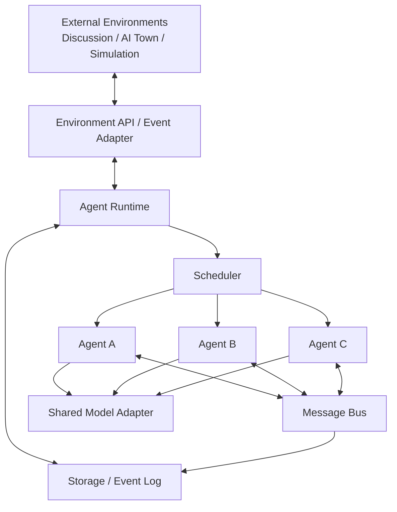
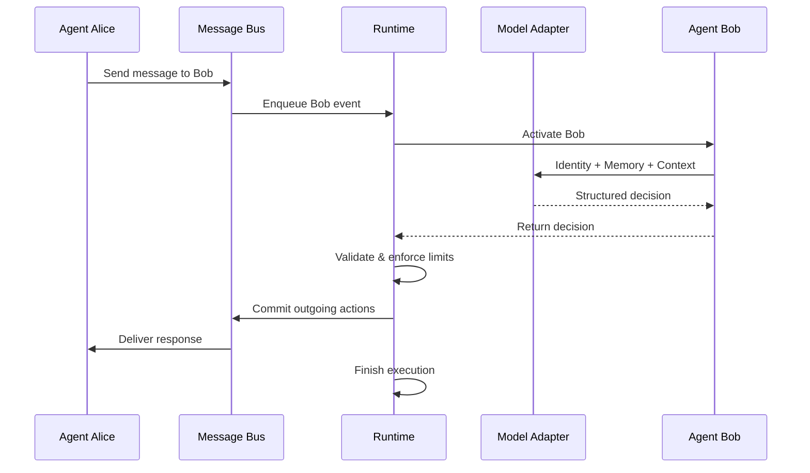

# Minimal Multi-Agent Runtime (MMAR)
## 系统架构与技术设计文档

**版本：** v0.1 Draft  
**状态：** 初步架构设计  
**技术栈：** Python 3.11+ / asyncio / LLM API  
**设计原则：** Minimal, Event-Driven, Composable, Extensible

---

# 1. 项目概述

## 1.1 项目目标

Minimal Multi-Agent Runtime（MMAR）是一个超轻量级、事件驱动、可组合的多智能体运行时系统。

其主要目标是以最小的运行开销和实现复杂度，同时实例化和管理大量逻辑 Agent，并允许这些 Agent 通过消息协议自主交互。

系统不预设 Agent 的协作关系、任务流程或者运行环境。

开发者可以利用 MMAR 构建：

- 多 Agent 自由讨论系统
- 多 Agent 辩论与集体决策系统
- 模拟社会与 AI Town
- 多 Agent 协作实验平台
- 可扩展的 Agent 行为研究环境

MMAR 只提供这些系统所需的底层 Agent 运行和通信能力。

## 1.2 核心设计理念

### Principle 1：Agent 极简化

一个 Agent 由三个核心概念构成：

1. Identity：描述身份和行为准则。
2. Memory：保存长期记忆。
3. Communication：接收和产生消息。

其外部表现为：

```text
Agent
├── agent.md
├── memory.md
└── Message Interface
```

Model Adapter 和 Runtime 属于共享基础设施，不需要每个 Agent 分别实现。

### Principle 2：Agent 与 Runtime 分离

Agent 负责决定自己的行为。

Runtime 负责执行和管理这些行为。

Agent 不需要自行管理任务调度、并发、消息投递或生命周期。

### Principle 3：通信优先

Agent 之间不存在默认的主从关系。

Agent 可以自主决定：

- 是否回复收到的消息。
- 回复哪个 Agent。
- 是否主动联系其他 Agent。
- 是否向多个 Agent 发送消息。
- 是否向一个讨论组广播消息。
- 是否保持沉默。

Runtime 不应替 Agent 决定讨论内容或通信对象，但可以执行必要的资源与安全约束。

### Principle 4：按需执行

Agent 不需要对应独立进程或常驻执行任务。

未激活的 Agent 只需要保留自身状态。

收到消息后，由 Runtime 调度 Agent 执行一次。

### Principle 5：环境无关

MMAR 不依赖 AI Town、Web 应用、游戏引擎或其他上层环境。

外部系统通过统一协议与 MMAR 交互。

---

# 2. 系统范围

## 2.1 MVP 必须具备的能力

| 能力 | 说明 |
|---|---|
| Agent 定义 | 使用 agent.md 定义身份 |
| Agent 记忆 | 使用 memory.md 保存持久记忆 |
| 消息通信 | Agent 间点对点通信 |
| 多目标通信 | 一次行动向多个 Agent 发送消息 |
| 群组广播 | 向指定群组发送消息 |
| 自主决策 | LLM 决定接收消息后的通信行为 |
| 异步执行 | 多个 Agent 可并发调用模型 |
| 动态注册 | 外部 Runtime API 注册和移除 Agent |
| 事件记录 | 保存消息及状态变更记录 |
| 运行控制 | 启动、暂停、停止运行 |
| API 接入 | 外部系统可以注入事件、订阅输出 |

## 2.2 MVP 明确不实现

- Agent 自主创建或删除其他 Agent。
- Agent 自主执行 Shell、Python 或任意外部工具。
- Agent 自主修改 agent.md。
- 完整的 Workflow/DAG 编排引擎。
- 多机分布式执行。
- 长期自主规划系统。
- 复杂向量数据库和 RAG。
- 图形化 Agent 小镇。
- 多模态感知与行动。

这些能力都不应成为核心 Runtime 的强制依赖。

---

# 3. 系统总体架构



## 3.1 Agent

Agent 是系统最基本的逻辑实体。

每个 Agent 具有唯一标识符、身份描述和持久记忆。

Agent 主要负责：

1. 接收 Runtime 提供的消息和上下文。
2. 基于身份、记忆和消息调用 LLM。
3. 产生结构化行为决策。
4. 将行为决策返回 Runtime。

Agent 不直接调用其他 Agent 的函数，也不直接操作 Message Bus 的内部队列。

## 3.2 Message Bus

Message Bus 是 Agent 之间统一的通信组件。

负责：

- 消息路由
- 消息投递
- 点对点通信
- 群组广播
- 收件队列管理
- 消息事件发布

Message Bus 不负责理解消息的自然语言内容。

## 3.3 Runtime

Runtime 是整个系统的核心控制组件。

负责：

- Agent 注册与管理
- Agent 生命周期
- 调度任务
- 消息执行限制
- 行为验证与提交
- 运行状态管理
- 外部事件接入

Runtime 是基础设施控制中心，但不是决定 Agent 讨论行为的 Supervisor。

## 3.4 Scheduler

Scheduler 负责选择下一批需要执行的 Agent。

MVP 采用 Reactive Scheduling：

**Agent 收到消息后进入待执行状态，由 Scheduler 分配执行机会。**

每个 Agent 同时最多执行一次推理，防止自身状态的并发竞争。

不同 Agent 之间允许并发推理。

## 3.5 Model Adapter

Model Adapter 提供统一的模型调用接口。

初期兼容 OpenAI-style Chat Completions API。

未来可以通过 Adapter 支持其他模型服务和本地推理服务。

Model Adapter 不应依赖特定 Agent 的身份格式或记忆存储方式。

## 3.6 Storage

Storage 负责 Agent 状态和事件持久化。

MVP 采用：

- Markdown：身份和长期记忆。
- SQLite：消息、事件、运行会话和必要的执行状态。

不要求部署独立数据库服务。

---

# 4. Agent 数据模型

## 4.1 Agent 的最小定义

Agent 可以形式化表示为：

Agent = (ID, Identity, Memory)

Agent 的核心执行函数定义为：

step(AgentState, InputContext) → AgentDecision

其中：

- AgentState：当前身份与记忆。
- InputContext：本轮消息及有限上下文。
- AgentDecision：结构化的通信与记忆更新意图。

该函数在语义上可以视为状态转换，但实际 LLM 调用是非确定性的，且存在外部副作用。

## 4.2 agent.md

```markdown
# Agent: Alice

## Identity
你是一位人工智能研究员。

## Personality
- 理性
- 好奇
- 喜欢质疑观点

## Goals
研究多智能体之间的协作行为。

## Communication Style
- 可以主动提出问题
- 可以联系多个 Agent
- 可以保持沉默
- 避免无意义的重复表达
```

Runtime 将 agent.md 作为身份指令注入模型上下文。

该文件由用户或外部管理系统维护。

Agent 不能直接修改它。

## 4.3 memory.md

```markdown
# Memory

## Knowledge
- Bob 研究分布式系统。
- Charlie 关注社会模拟。

## Previous Discussions
- 与 Bob 讨论过去中心化 Agent。
- 与 Charlie 讨论过群体涌现行为。

## Current Interests
- Agent 自主通信
- 群体决策机制
```

memory.md 保存跨执行轮次保留的长期信息。

它不应充当完整的消息历史。

## 4.4 内部执行状态

除上述两个 Markdown 文件外，Runtime 可以维护如下临时状态：

```python
@dataclass
class AgentState:
    agent_id: str
    status: str
    pending_messages: int
    last_active_at: float | None
    execution_count: int
```

这些数据不属于 Agent 的身份与长期记忆，而是运行时元数据。

---

# 5. 消息协议

## 5.1 Message Schema

所有通信使用统一的结构化消息。

```json
{
  "message_id": "msg_001",
  "sender": "alice",
  "receiver": "bob",
  "type": "direct",
  "content": "你怎么看去中心化的 Agent 系统？",
  "conversation_id": "conv_001",
  "created_at": "2026-10-10T10:00:00Z"
}
```

### 基础字段

| 字段 | 类型 | 说明 |
|---|---|---|
| message_id | string | 全局唯一消息 ID |
| sender | string | 发送者 |
| receiver | string | 接收目标 |
| type | string | direct/group/system |
| content | string | 消息正文 |
| conversation_id | string | 会话关联 ID |
| created_at | string | UTC 时间戳 |

MVP 中 direct 和 group 是核心通信类型。

system 消息由 Runtime 或可信外部系统产生，不能由普通 Agent 冒充。

## 5.2 Agent Decision Schema

Agent 的模型输出不应只是普通字符串，而应是一份结构化决策。

```json
{
  "actions": [
    {
      "type": "send",
      "targets": ["bob", "charlie"],
      "content": "我认为值得进一步讨论这个问题。"
    }
  ],
  "memory_update": null
}
```

允许的通信 Action：

| Action | 行为 |
|---|---|
| send | 发送给一个或多个 Agent |
| broadcast | 向已有群组广播 |
| noop | 不进行通信 |

其中 `send` 的 targets 可以包含多个已注册 Agent。

`broadcast` 必须指向已经存在且允许当前 Agent 发言的群组。

`noop` 代表当前轮次没有外发消息。

## 5.3 Memory Update

Agent 可以提出记忆更新意图。

例如：

```json
{
  "actions": [
    {
      "type": "noop"
    }
  ],
  "memory_update": {
    "mode": "replace",
    "content": "# Memory\n\n- Bob 关注去中心化架构。"
  }
}
```

MVP 使用完整替换模式，避免复杂的记忆编辑操作。

Runtime 负责限制内容长度并原子写入文件。

需要注意：

- Memory Update 不代表修改身份。
- Memory Update 不应修改其他 Agent 的记忆。
- 模型输出不是可信指令，Runtime 必须校验。
- 未来可以替换为摘要合并、增量更新或其他 Memory Plugin。

---

# 6. Agent 执行生命周期

MVP 采用事件驱动模型。



## 6.1 完整执行流程

1. Message Bus 接收消息。
2. 校验消息目标并写入待处理队列。
3. Scheduler 判断目标 Agent 是否可执行。
4. Runtime 加载 Agent 身份、记忆和上下文。
5. Model Adapter 调用 LLM。
6. LLM 返回结构化 AgentDecision。
7. Runtime 验证输出是否合法。
8. Runtime 持久化经过校验的记忆变更。
9. Runtime 提交通信行为。
10. 目标 Agent 收到新消息并等待下一轮调度。

## 6.2 执行规则

每个 Agent 同一时刻只能有一个执行中的 step。

多个不同 Agent 可以并发执行。

Agent 执行完成后可以再次进入待调度状态。

Runtime 不保证 Agent 的消息回复一定会产生后续通信。

Agent 可以自由选择沉默。

## 6.3 收件箱策略

MVP 推荐使用按 Agent 分组的消息队列。

如果一个 Agent 在等待调度时收到了多条消息，可以将有限数量的消息合并到一次模型调用中。

这可以减少高频讨论场景中的模型调用量。

不过系统必须保留消息 ID 和原始顺序，以便调试与回放。

---

# 7. 调度与并发

## 7.1 Reactive Scheduling

MVP 默认采用消息触发式执行。

Agent 在以下情况下可以被激活：

- 收到其他 Agent 发送的消息。
- 收到外部环境注入的事件。
- Runtime 接收到显式的激活请求。

MVP 不支持 Agent 自行设置定时任务。

## 7.2 全局并发限制

Runtime 维护共享并发信号量。

例如：

```python
self.semaphore = asyncio.Semaphore(20)
```

该配置允许同时最多 20 个 Agent 执行模型推理。

Agent 总数量与并发调用数量相互独立。

## 7.3 防止消息风暴

为避免 Agent 之间无限发送消息，MVP 必须实现：

- 每次 step 的最大消息动作数量。
- 每条消息的最大长度。
- 每个 Agent 的最大待处理消息数。
- 每个讨论会话的最大执行次数。
- 全局模型调用预算。
- 全局并发限制。
- 停止与取消机制。

达到预算后，Runtime 应停止对应范围内的新执行，并记录终止原因。

## 7.4 讨论终止

一次讨论不能仅通过队列暂时为空来判断结束，因为可能存在仍在进行的 LLM 调用。

只有满足以下条件才能认为讨论进入空闲状态：

- 没有待处理消息。
- 没有正在执行的 Agent。
- 没有等待提交的消息事件。

达到预算上限则属于强制终止，而非正常空闲结束。

---

# 8. Memory 与上下文管理

## 8.1 三层上下文

Agent 的模型输入由以下内容构成：

```text
Identity Context
    +
Persistent Memory
    +
Current Message Context
```

Identity Context 来自 agent.md。

Persistent Memory 来自 memory.md。

Current Message Context 来自 Runtime 存储的当前消息及有限历史。

## 8.2 Context Builder

Runtime 通过统一 Context Builder 组织模型输入。

```python
context = ContextBuilder.build(
    identity=agent.identity,
    memory=agent.memory,
    messages=current_messages,
    history=recent_history
)
```

Context Builder 应为每个部分设置长度预算。

## 8.3 长期记忆策略

MVP 使用 Markdown 长期记忆。

应限制 memory.md 的最大 token 数量。

当记忆超出预算时，可以拒绝本次更新并记录错误，而不是静默截断。

后续可增加独立的 Memory Consolidation 机制，通过摘要、筛选或结构化存储压缩长期记忆。

## 8.4 并发一致性

同一 Agent 的 step 串行执行，避免并发覆盖其记忆。

不同 Agent 的记忆相互隔离。

Memory Update 应使用临时文件与原子替换等机制，避免写入过程中破坏文件。

---

# 9. Environment Adapter

## 9.1 设计目标

MMAR 必须允许外部系统：

1. 创建或注册 Agent。
2. 向 Agent 注入事件。
3. 订阅 Agent 输出的通信事件。
4. 查询 Agent 状态。
5. 管理运行会话。

环境适配层不应要求修改 Agent Core。

## 9.2 MVP 接口

建议保留以下 Python 层接口：

```python
runtime.register_agent(agent_config)

await runtime.inject_message(message)

await runtime.start()

await runtime.stop()

runtime.subscribe(handler)
```

这些接口是内部 API，未来可以映射到 HTTP 或 WebSocket。

## 9.3 AI Town 集成方式

AI Town 负责：

- 世界状态
- 地图与位置
- 环境事件
- 角色可见性
- 行为执行规则

MMAR 负责：

- Agent 身份
- Agent 记忆
- 对事件的推理
- Agent 的通信决策

AI Town 可以向 MMAR 注入观察事件。

MMAR 可以通过事件订阅向 AI Town 提供 Agent 的通信输出。

但在 MVP 中，Agent 不直接生成移动、交易、物品交互等世界动作。

这类能力可以作为未来的受限 Action Adapter 扩展，并由外部环境进行授权和验证。

---

# 10. 安全与隔离

## 10.1 权限边界

MVP Agent 只具备通信能力。

Agent 无权：

- 访问任意文件。
- 修改其他 Agent 记忆。
- 修改自己的身份文件。
- 执行系统命令。
- 自行调用网络 API。
- 创建新的 Agent。

## 10.2 输出校验

Runtime 必须校验模型返回的 JSON。

包括：

- Action 类型是否合法。
- 目标 Agent 是否存在。
- 群组是否存在以及是否允许发送。
- 消息长度是否超限。
- 本轮 Action 数量是否超限。
- 记忆更新是否符合格式及大小限制。

不合法的输出不得直接执行。

## 10.3 不可信消息

其他 Agent 的消息内容不能被当作 Runtime 系统指令。

Context Builder 应区分：

- 开发者配置的身份指令。
- Runtime 协议约束。
- 其他 Agent 发送的不可信消息。
- Agent 的历史记忆。

身份文件和运行约束不能因为其他 Agent 的自然语言请求而被覆盖。

## 10.4 资源隔离

对每个 Agent、每个讨论和整个 Runtime 分别设置资源预算。

避免一个异常 Agent 消耗所有执行额度。

---

# 11. 错误处理与可观测性

## 11.1 错误类别

MVP 至少处理：

- LLM 请求超时。
- LLM API 限流。
- 非法结构化输出。
- 目标 Agent 不存在。
- 消息队列溢出。
- 记忆文件读取或写入失败。
- 会话预算超限。
- 执行中断与取消。

模型请求失败时采用有限重试和指数退避。

非法输出可以允许一次有限的格式修复重试，仍失败则记录错误并结束当前 step。

对持久化的消息使用唯一 ID 避免重试导致重复投递。

## 11.2 日志事件

建议记录：

```text
agent.registered
agent.activated
agent.completed
agent.failed

message.enqueued
message.delivered
message.rejected

memory.updated

session.started
session.idle
session.stopped
session.budget_exceeded
```

## 11.3 基础指标

需要能够观察：

- 已注册 Agent 数量。
- 活跃 Agent 数量。
- 待处理消息数量。
- 总模型调用次数。
- 每个 Agent 的调用次数。
- Token 消耗。
- LLM 调用延迟。
- 消息投递延迟。
- 失败率。
- 讨论执行步数。

这些指标用于判断系统是否真正具备可扩展性。

---

# 12. 项目目录结构

```text
mmar/
├── core/
│   ├── agent.py
│   ├── runtime.py
│   ├── scheduler.py
│   ├── message.py
│   ├── bus.py
│   ├── context.py
│   └── protocol.py
│
├── adapters/
│   ├── model.py
│   └── environment.py
│
├── storage/
│   ├── memory.py
│   └── event_store.py
│
├── agents/
│   ├── alice/
│   │   ├── agent.md
│   │   └── memory.md
│   └── bob/
│       ├── agent.md
│       └── memory.md
│
├── examples/
│   ├── simple_chat.py
│   └── group_discussion.py
│
├── tests/
│
├── pyproject.toml
└── README.md
```

模块目录仅代表职责划分，不要求每个模块都形成独立服务。

---

# 13. MVP 开发计划

## Milestone 1：单 Agent Runtime

完成：

- agent.md 加载
- memory.md 加载
- LLM 调用
- 结构化 Action 输出
- 单次 step 执行

验收：单个 Agent 可以接收消息并产生合法的通信决策。

## Milestone 2：Multi-Agent Communication

完成：

- Agent 注册表
- Message Bus
- 点对点通信
- 多目标消息
- 群组广播
- noop 行为
- 基础讨论示例

验收：至少 10 个 Agent 可以在不预定义发言顺序的情况下开展讨论。

## Milestone 3：Async Runtime

完成：

- asyncio 调度
- 全局并发控制
- 同一 Agent 串行执行
- 消息队列
- 运行预算
- 会话空闲检测

验收：大量逻辑 Agent 可以注册，且并发模型调用数量受到统一限制。

## Milestone 4：Persistence & Observability

完成：

- SQLite 事件存储
- Agent 记忆更新
- 消息历史记录
- 运行日志
- 基础统计指标

验收：能够查询一次讨论产生的消息、模型调用、记忆更新和终止原因。

## Milestone 5：Environment Integration

完成：

- 环境事件注入
- 通信事件订阅
- 外部 API 适配
- 可复用讨论环境示例

验收：外部程序不需要修改 Agent Core，就可以创建讨论会话并消费 Agent 输出。

---

# 14. 测试与验收标准

## 14.1 功能测试

- Agent 能正确加载 identity 和 memory。
- Agent 能发送、广播或选择沉默。
- 非法收件人不会产生有效投递。
- Runtime 能拒绝不支持的 Action。
- Agent 的记忆修改不会影响其他 Agent。
- 外部系统可以注入消息。
- Runtime 能正确停止讨论。

## 14.2 并发测试

- 同一个 Agent 不会并发执行两个 step。
- 不同 Agent 可以并发执行。
- 全局执行并发不会超过配置值。
- 队列达到上限后执行明确的溢出策略。
- 取消任务后不会留下未管理的执行状态。

## 14.3 性能测试

建议使用 Mock Model Adapter，将模型推理替换为固定延迟的模拟响应。

测试规模：

- 10 Agents
- 100 Agents
- 1,000 Agents

分别记录初始化时间、运行时内存、消息吞吐量和调度延迟。

再使用真实 LLM API 进行小规模端到端测试，单独评估模型服务的延迟、Token 成本和速率限制。

不能将成功注册 1,000 个 Agent 等同于支持 1,000 个 Agent 同时进行真实模型推理。

## 14.4 MVP 完成条件

只有满足以下条件，才认为 MVP 完成：

1. 多个 Agent 可以自主选择通信目标。
2. 系统不依赖固定的讨论顺序。
3. Agent 能够保持沉默。
4. Runtime 能够限制模型调用并发和消息数量。
5. 长期记忆可持久化且相互隔离。
6. 消息和执行事件可追踪。
7. 外部环境可以通过稳定接口接入。
8. 核心运行时不依赖复杂的 Agent Framework。

---

# 15. 后续扩展方向

MMAR 的后续扩展应围绕稳定的 Agent、Message、Decision 和 Runtime 接口开展。

潜在方向包括：

- Tick-based Scheduler
- Hybrid Scheduler
- HTTP / WebSocket Gateway
- AI Town Environment Adapter
- 分布式 Message Bus
- Pluggable Memory Backend
- Agent 行为分析与可视化
- 多 Agent 协作评估与 Benchmark
- Agent 社会网络与涌现行为研究

这些功能作为独立扩展实现，不应迫使最小 Agent 增加不必要的内置能力。

---

# 16. 当前架构决策

| 决策项 | v0.1 方案 |
|---|---|
| 编程语言 | Python |
| 核心执行方式 | asyncio |
| Agent 定义 | agent.md + memory.md |
| Agent 自主性 | 方案 B |
| Agent 通信 | 结构化消息 |
| 通信拓扑 | 动态、多对多 |
| Message Bus | 进程内 |
| Scheduling | Reactive |
| 模型接口 | OpenAI-compatible API |
| 持久化 | Markdown + SQLite |
| Agent 进程模型 | 多逻辑 Agent 共享进程 |
| 环境集成 | Adapter / Event API |
| 复杂 Framework | 不作为必需依赖 |

---

# 17. 总结

MMAR 的核心并不是实现一个功能丰富的 Agent 框架，而是实现一个尽可能小、稳定且可组合的 Agent 执行基础。

Agent 负责自主决策。

Runtime 负责可靠执行。

Message Bus 负责通信。

Environment 负责赋予 Agent 更复杂的外部世界。

**系统应允许开发者在不修改 Agent 核心抽象的情况下，从两个 Agent 的简单对话扩展到具有大量 Agent 的交互环境。**

这就是 MMAR v0.1 的核心设计目标。